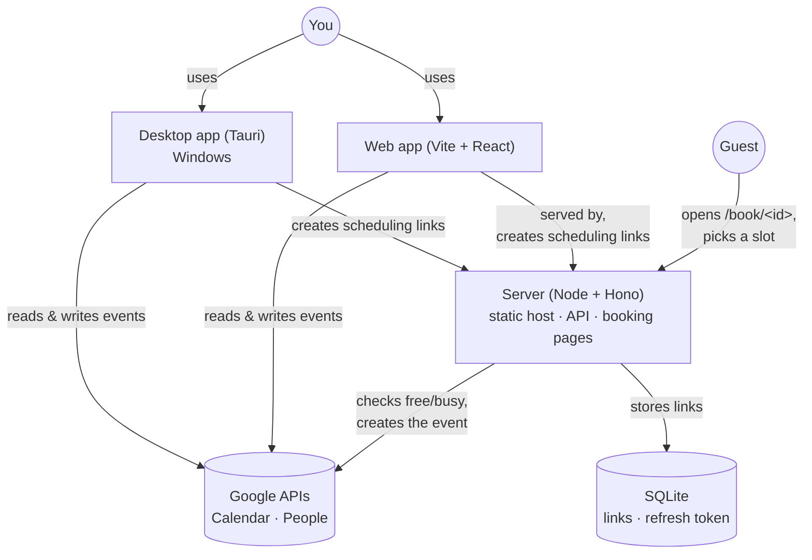

<div align="center">
  

  # Calendar

  **A lightweight Google Calendar client with a Notion Calendar–style UI, using a fraction of the RAM and CPU, plus self-hosted scheduling links.**

  [](#--disclaimer)
  [](LICENSE)
  [](https://tauri.app)
  [](https://react.dev)
  [](https://nodejs.org)
  [](https://nodejs.org/api/sqlite.html)
  [](https://calendar.bayfield.dev)
</div>


## ⚠️ • Disclaimer

This is a personal project built for my own Google account, not a polished product: expect missing pieces, sharp edges, and breaking changes. The Google OAuth app is meant to run unverified (personal use), so you'll click past Google's "unverified app" warning when signing in.


## 📋 • Table of Contents

- [📖 • Overview](#--overview)
- [🧩 • Components](#--components)
- [🛠️ • Tech Stack](#️--tech-stack)
- [🚀 • Getting Started](#--getting-started)
  - [Prerequisites](#prerequisites)
  - [Installation](#installation)
  - [Google Setup](#google-setup)
  - [Environment Variables](#environment-variables)
  - [Running Locally](#running-locally)
- [🧪 • Demo Mode](#--demo-mode)
- [🔐 • How Sign-in Works](#--how-sign-in-works)
- [⌨️ • Keyboard Shortcuts](#️--keyboard-shortcuts)
- [❤️ • Health Check](#️--health-check)
- [📁 • Project Structure](#--project-structure)
- [🐳 • Docker Deployment](#--docker-deployment)
- [📦 • Releases](#--releases)
- [🤝 • Contributing](#--contributing)
- [🙌 • Credits](#--credits)
- [📄 • License](#--license)


## 📖 • Overview

Calendar talks directly to the Google Calendar API. It runs as a **Tauri 2 desktop app** (using the system WebView2 instead of bundling Chromium) and as a **web app** served by a small Node + SQLite server, which also powers scheduling links.

**Way lighter than Notion Calendar.** Notion Calendar ships its own copy of Chromium through Electron. This app reuses the WebView2 runtime already built into Windows and keeps the app itself small, so it uses far less RAM and CPU, starts faster, and can sit in the tray all day without slowing your computer down.

Key features:
- 1–14 day views, `Shift` + scroll to move day by day, resizable sidebar
- Create events by dragging; move and resize them; edit everything in the side panel (time, recurrence, guests, Google Meet, location, description, calendar, color, busy/free, visibility)
- Multi-select, cut / copy / paste, duplicate, and undo / redo
- **Schedule (Planifier):** drag the slots you're free, get a link, and the other person picks a time. The server checks your free/busy live and creates the event with them invited
- Search across events, places, and people
- Guest autocompletion from your Google contacts, and place suggestions from Google Maps or OpenStreetMap
- Privacy mode to hide event details when sharing your screen
- Desktop: keeps running in the system tray so reminders still fire, can launch at startup, and shows a notification for each event's popup reminders (all three can be turned off in Settings)
- Themes: System, Light, Dark, Rosé Pine, Rosé Pine Dawn. UI in French or English


## 🧩 • Components



| Component | Description |
|---|---|
| [`src`](src) | The React app: week view, side panel, search, settings. Shared by the web and desktop builds. [`src/book`](src/book) is the public booking page. |
| [`src-tauri`](src-tauri) | The Tauri 2 shell: desktop OAuth (loopback + PKCE), Windows Credential Manager storage, system tray, autostart, and notifications. |
| [`server`](server) | A Hono server on Node that serves the web build and booking pages, stores scheduling links in SQLite, and books events on the owner's calendar with its own Google refresh token. |


## 🛠️ • Tech Stack

| Layer | Technology |
|---|---|
| Frontend | [React 19](https://react.dev), TypeScript, [Vite](https://vite.dev) |
| Desktop | [Tauri 2](https://tauri.app) (Rust, WebView2), tray / notification / autostart / single-instance plugins |
| Server | Node.js ≥ 24, [Hono](https://hono.dev) |
| Database | SQLite via the built-in [`node:sqlite`](https://nodejs.org/api/sqlite.html) |
| APIs | Google Calendar API, Google People API, Google Places API (New) *(optional)*, [Photon](https://photon.komoot.io) (OpenStreetMap) |
| Auth | Google OAuth 2.0 (Google Identity Services on web, loopback + PKCE on desktop) |
| Containerization | Docker Compose, images on `ghcr.io` |


## 🚀 • Getting Started

### Prerequisites

- [Node.js](https://nodejs.org) ≥ 24 and npm
- *(Desktop build only)* Rust and the MSVC C++ build tools: see [Tauri prerequisites](https://tauri.app/start/prerequisites/)
- *(Deployment only)* Docker & Docker Compose, and a reverse proxy
- A Google Cloud project (see [Google Setup](#google-setup))

### Installation

```sh
# 1. Clone the repository
git clone https://github.com/PaulBayfield/calendar.bayfield.dev.git
cd calendar.bayfield.dev

# 2. Install the app's and the server's dependencies
npm install && npm --prefix server install

# 3. Copy the env files, then fill them in
cp .env.example .env.local
cp server/.env.example server/.env
```

### Google Setup

One-time setup in [Google Cloud Console](https://console.cloud.google.com/):

1. Create a project and enable the **Google Calendar API** and the **People API** (used to suggest guest emails from your contacts).
2. **Google Auth Platform → Branding:** set an app name. **Audience:** *External*, then **Publish app** (in *Testing*, Google expires sign-ins every 7 days; personal use doesn't need verification, you'll just click past an "unverified app" warning). **Data access:** add `https://www.googleapis.com/auth/calendar`, `https://www.googleapis.com/auth/contacts.readonly` and `https://www.googleapis.com/auth/contacts.other.readonly` (the last two are read-only and only used for guest autocompletion; without them, suggestions come from people already in your events).
3. **Clients → Web application.**
   - Authorized JavaScript origins: `http://localhost:1420`, `https://calendar.bayfield.dev`
   - Authorized redirect URIs: `https://calendar.bayfield.dev/api/google/callback` (plus `http://localhost:8787/api/google/callback` if you run the server locally)
   - Copy the client ID **and** secret (the secret is only used by the server).
4. **Clients → Desktop app.** Copy the client ID and secret.
5. *Optional, for Google Maps place suggestions:* enable **Places API (New)**, create an API key restricted to that API and to the referrers `http://localhost:1420/*`, `https://calendar.bayfield.dev/*` and `http://tauri.localhost/*`, and set `VITE_GOOGLE_MAPS_API_KEY`. Without a key, places come from OpenStreetMap (free) plus the places you've already used.

If you signed in before the contacts permissions were added, sign out and back in once so Google asks for them.

### Environment Variables

**1. [`.env.example`](.env.example) → `.env.local`**, read by Vite at build time. These end up in the JS bundle, so treat them as public:

| Variable | Required | Description |
|---|---|---|
| `VITE_GOOGLE_WEB_CLIENT_ID` | **Yes** (web) | "Web application" OAuth client ID |
| `VITE_GOOGLE_DESKTOP_CLIENT_ID` | **Yes** (desktop) | "Desktop app" OAuth client ID |
| `VITE_GOOGLE_DESKTOP_CLIENT_SECRET` | **Yes** (desktop) | "Desktop app" client secret (Google doesn't treat installed-app secrets as confidential, but keep `.env.local` out of git anyway) |
| `VITE_API_URL` | No (default `https://calendar.bayfield.dev`) | Scheduling server the desktop build talks to; the web build uses its own origin |
| `VITE_GOOGLE_MAPS_API_KEY` | No | Google Places autocomplete for locations; falls back to OpenStreetMap |

**2. [`server/.env.example`](server/.env.example) → `server/.env`**, read by the server (locally or in Docker):

| Variable | Required | Description |
|---|---|---|
| `PUBLIC_URL` | **Yes** | Where the server is reachable from the internet (booking links, OAuth redirect) |
| `PORT` | No (default `8787`) | Port to listen on |
| `OWNER_EMAIL` | **Yes** | The only Google account allowed to create links and connect the server |
| `OWNER_NAME` | No | Shown on booking pages |
| `GOOGLE_CLIENT_ID` | **Yes** | "Web application" OAuth client ID |
| `GOOGLE_CLIENT_SECRET` | **Yes** | "Web application" OAuth client secret |
| `GOOGLE_DESKTOP_CLIENT_ID` | **Yes** (desktop) | "Desktop app" client ID, so the desktop build can call the API too |
| `DATA_DIR` | No (default `./data`) | Where the SQLite database lives (set to `/data` in Docker) |
| `CLIENT_IP_HEADER` | No | Header your reverse proxy puts the visitor IP in, used for rate limiting (e.g. `cf-connecting-ip` behind a Cloudflare Tunnel) |
| `CORS_ORIGINS` | No | Extra origins allowed to call the API (defaults cover the Tauri app and the Vite dev server) |

### Running Locally

```sh
npm run dev          # web UI, http://localhost:1420
npm run server       # scheduling server on :8787 (Vite proxies /api to it); needs server/.env
npm run tauri dev    # desktop app
npm run tauri build  # desktop installer → src-tauri/target/release/bundle/
```


## 🧪 • Demo Mode

Open the web UI with `?demo` to load sample data instead of your Google account, no Google setup needed:

```sh
npm run dev
# then open http://localhost:1420/?demo
```

The fixtures live in [`src/lib/demo.ts`](src/lib/demo.ts). Nothing is sent to Google, and changes aren't persisted.


## 🔐 • How Sign-in Works

- **Desktop:** OAuth in your browser (loopback redirect + PKCE) in [`src-tauri/src/lib.rs`](src-tauri/src/lib.rs). The refresh token is kept in Windows Credential Manager.
- **Web:** Google Identity Services. Tokens last an hour; after that the app asks you to reconnect.
- **Server:** owner requests carry the app's Google access token, which the server verifies with Google. The server keeps its own refresh token (from **Settings → Scheduling server → Connect Google**) so bookings work while your laptop is off.


## ⌨️ • Keyboard Shortcuts

| Key | Action |
|---|---|
| `Ctrl+K` or `/` | Search events, places, people |
| `T` | Today |
| `J` / `→` · `K` / `←` | Next / previous |
| `Shift` + scroll | Move day by day |
| `1`–`9`, `0` · `D` · `W` | 1–10 day view · day · week |
| `C` | New event |
| `Ctrl` + click | Select several events |
| `Ctrl+Z` / `Ctrl+Y` | Undo / redo |
| `Ctrl+X` / `Ctrl+C` / `Ctrl+V` | Cut / copy / paste |
| `Ctrl+D` | Duplicate event |
| `Del` | Delete selected event (with undo) |
| `Ctrl+B` (or `\`) · `.` | Toggle sidebar · side panel |
| `H` | Privacy mode |
| `Ctrl+,` | Settings |
| `Esc` | Close / cancel |


## ❤️ • Health Check

The server exposes an unauthenticated health check at `/api/health`:

```sh
curl http://localhost:8787/api/health
```

```json
{ "ok": true }
```

Useful for uptime monitors, container health checks, or a reverse proxy readiness probe.


## 📁 • Project Structure

```
calendar.bayfield.dev/
├── .github/workflows/
│   ├── ci.yml                  # Type-checks and builds the web app and server
│   ├── deployment.yaml         # Builds & publishes the Docker image to ghcr.io
│   └── release.yml             # Builds Windows installers on version tags
├── src/                        # React app (shared by web and desktop)
│   ├── components/             # WeekView, EventPanel, Sidebar, SchedulePanel, SettingsDialog, ...
│   ├── lib/                    # Google API, auth, i18n, settings, places, reminders, demo data
│   ├── book/                   # Public booking page (/book/<id>)
│   └── App.tsx
├── src-tauri/                  # Tauri 2 desktop shell (Rust)
│   ├── src/lib.rs              # Desktop OAuth, credential storage, tray, notifications
│   └── tauri.conf.json
├── server/                     # Node + Hono server
│   └── src/
│       ├── index.ts            # API routes, static hosting, booking pages
│       ├── google.ts           # Google OAuth, free/busy, event creation
│       └── db.ts               # SQLite storage (node:sqlite)
├── index.html                  # App entry
├── book.html                   # Booking page entry
├── Dockerfile
└── docker-compose.yml
```


## 🐳 • Docker Deployment

One container serves the web app, the booking pages (`/book/<id>`) and the API. SQLite lives in the `/data` volume.

```sh
# server/.env holds PUBLIC_URL, OWNER_EMAIL, GOOGLE_CLIENT_ID/SECRET, GOOGLE_DESKTOP_CLIENT_ID…
VITE_GOOGLE_WEB_CLIENT_ID=xxx.apps.googleusercontent.com docker compose up -d --build
```

Pushing to `main` builds and publishes the image to [`ghcr.io/paulbayfield/calendar.bayfield.dev`](https://github.com/PaulBayfield/calendar.bayfield.dev/pkgs/container/calendar.bayfield.dev) (tagged `latest` and the `package.json` version) via [`deployment.yaml`](.github/workflows/deployment.yaml). Set the repository **variables** `VITE_GOOGLE_WEB_CLIENT_ID` and, optionally, `VITE_GOOGLE_MAPS_API_KEY` (Settings → Secrets and variables → Actions → Variables); they end up in the public JS bundle, so they don't need to be secrets.

Put it behind your reverse proxy at `https://calendar.bayfield.dev` → `localhost:8787`. Then in the app open **Settings → Scheduling server** and click **Connect Google** once. That gives the server its own refresh token so bookings work while your laptop is off. Only `OWNER_EMAIL` can create links or connect.


## 📦 • Releases

Bump `version` in `package.json` (the app reads it from there), commit, then push a matching tag:

```sh
git tag v0.2.0 && git push origin v0.2.0
```

[`release.yml`](.github/workflows/release.yml) builds the Windows installers and attaches them to a **draft** GitHub release; publish it when you're happy. The build reads the repository **variables** `VITE_GOOGLE_DESKTOP_CLIENT_ID`, `VITE_API_URL`, `VITE_GOOGLE_MAPS_API_KEY` and the **secret** `VITE_GOOGLE_DESKTOP_CLIENT_SECRET`.


## 🤝 • Contributing

This is a personal, single-maintainer project (see [Disclaimer](#--disclaimer)), so there's no formal `CONTRIBUTING.md` or process. Issues and pull requests are still welcome if something's broken or you have a suggestion.


## 🙌 • Credits

| Person | Role |
|---|---|
| [Paul Bayfield](https://github.com/PaulBayfield) | Creator & maintainer |

Calendar also relies on a few external services:

| Service | Used for |
|---|---|
| [Google Calendar API](https://developers.google.com/calendar) | Reading and writing events, free/busy for scheduling links |
| [Google People API](https://developers.google.com/people) | Guest email suggestions from your contacts |
| [Google Places API (New)](https://developers.google.com/maps/documentation/places/web-service) *(optional)* | Location suggestions |
| [Photon](https://photon.komoot.io) ([OpenStreetMap](https://www.openstreetmap.org) data) | Free location suggestions when no Maps key is set |
| [Rosé Pine](https://rosepinetheme.com) | The Rosé Pine and Rosé Pine Dawn themes |


## 📄 • License

Calendar is licensed under the [AGPL 3.0](LICENSE).

```
Calendar
Copyright (C) 2026 Paul Bayfield

This program is free software: you can redistribute it and/or modify
it under the terms of the GNU Affero General Public License as published by
the Free Software Foundation, either version 3 of the License, or
(at your option) any later version.

This program is distributed in the hope that it will be useful,
but WITHOUT ANY WARRANTY; without even the implied warranty of
MERCHANTABILITY or FITNESS FOR A PARTICULAR PURPOSE.  See the
GNU Affero General Public License for more details.

You should have received a copy of the GNU Affero General Public License
along with this program.  If not, see <http://www.gnu.org/licenses/>.
```
